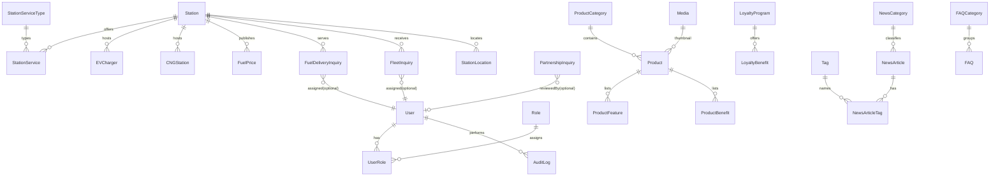

# ENERGY MOBILITY — PHASE 1: WEBSITE AUDIT & ARCHITECTURE

**Placeholder brand:** ENERGY MOBILITY
**Reference (audit only):** https://www.jiobp.com/ (Drupal 9, confirmed from page source)
**Stack:** Next.js (App Router) + NestJS + PostgreSQL + Prisma + TypeScript
**Legal note:** This document captures only publicly visible *information architecture*, navigation patterns, and UX requirements. No source code, logo, images, CSS, JS, APIs, or verbatim copy from the reference site is used. The reference was removed from subsequent phases and this is our own original implementation.

---

## 1. WEBSITE AUDIT

### A. Global structure (verified in rendered HTML)

| Element | Observed behavior |
|---|---|
| Header | Fixed top bar, full width, logo left, nav right |
| Primary navigation | 8 top-level items: Who We Are · Products & Services · Partners · Newsroom · Tender · Investor Relations · TalentHub · Connect with Us |
| Mega menus | None verified — each top-level item is a plain link; content organized via in-page tabbed sections / section anchors (e.g., `#fuel-retail`, `#non-fuel`, `#convenience`, `#electric-mobility`, `#aviation`, `#loyalty-program`) |
| Header utilities | Search icon (opens search bar with results), station-locator icon (`/locate-fuel-station`) |
| Sticky social rail | Left-side vertical social links (Facebook, YouTube, LinkedIn, X, Instagram) on desktop |
| Hero | Full-width banner image (desktop + mobile variant via `<picture>`), page title overlay; homepage uses a static hero image, not carousel |
| Service cards | Image/icon + title + description + "Know More" link; carousels (Swiper) for "Why Jio-bp" and Products & Services |
| Tabs | Products & Services uses 6 tabs: Fuel Retail / Non-Fuel / Convenience / Electric Mobility / Aviation / Loyalty Program |
| CTA buttons | "Know More", "Apply Now" (→ external `partners.jiobp.in`), "Read More", "Read all other FAQ's", "Learn More" |
| Location finder | `/locate-fuel-station`: State + City dropdowns → station cards with RO code/ID, contact person, fuel prices (₹/L), amenities (Washroom, Air, Lubricants, Drinking Water, Truck Stop, Food Plaza); city shortcuts (Delhi, Bangalore, Mumbai, Chennai) |
| News | `/news-room` with dated press-release list (`/news/[slug]`), "Load More" pagination, media-queries form |
| FAQ | Accordion; homepage shows subset + "Read all other FAQ's"; `/faqs` has category tabs; JSON-LD FAQ schema present |
| Footer | 5 link columns (Who We Are / Products & Services / Newsroom / Investor Relations / Connect) + bottom bar (copyright, Privacy Policy, Disclaimer). Desktop + mobile variants |
| Legal links | Privacy Policy (`/privacy-policy`), Disclaimer (`/disclaimer`). Other legal pages **not verified** |
| External integrations | Salesforce chat bot, GTM, Meta Pixel, Swiper, AOS, GSAP, Bootstrap 4 — referenced for structure only, none copied |
| Station detail | Individual station pages live on a **separate subdomain** (`mobilitystation.jiobp.com/location/...`) — station detail on `jiobp.com` itself is **not present** |

### B. Pages — verified vs unverified

**Corporate**
- ✅ `/` Homepage
- ✅ `/who-we-are` (Purpose teaser, At a Glance, **Our Vision**, **Our Mission**, Quick Overview)
- ✅ `/who-we-are/our-purpose` (footer link "Why Jio-bp")
- ✅ `/who-we-are/at-a-glance` (footer link "At a Glance")
- ❌ `/who-we-are/leadership` — **UNVERIFIED** (leadership shown via testimonials on Careers page instead)
- ❌ Dedicated sustainability page — **UNVERIFIED**

**Products & Services** (all ✅ verified as real routes)
- `/products-and-services` (hub with tabs)
- `/products-and-services/fuels-at-jio-bp` — Fuel
- `/products-and-services/EV-charging` — EV charging (+ `/ev-saver` subscription plans)
- `/products-and-services/cng` — CNG
- `/products-and-services/fuel4u` — Doorstep diesel delivery
- `/products-and-services/trans-connect` — Fleet management
- `/products-and-services/castrol` — Lubricants / Oil change
- `/products-and-services/nitrofill` — Nitrogen tyre inflation
- `/products-and-services/wild-bean-cafe` — Café + Convenience Store (`#store`)
- `/products-and-services/Refresh` — Food plaza
- `/products-and-services/flexipay` — Payments
- `/products-and-services/airbp_aviation` — Aviation fuel
- `/products-and-services/RewardMeter-Program` + `/products-and-services/jio-bp-4ever` — Loyalty
- `/indusind-jio-bp-credit-card` — co-branded credit card (own root path)

**Mobility / Locator**
- ✅ `/locate-fuel-station` — State/City locator with fuel prices & amenities
- ❌ `/locate/ev-charging`, `/locate/cng` — **UNVERIFIED**; EV page embeds its own state-based locator in-page

**Business / Partnerships**
- ✅ `/partners` — Mobility Station dealership, Mobile Dispenser Unit (MDU), generic partner form
- ✅ Partnership application handled externally (`partners.jiobp.in` for stations, `fuel4u.com` for MDU)

**Customer support**
- ✅ `/connect-with-us` — hub: Collaborate, Feedback, Locate, FAQs, Ethics & Compliance, Call Back
- ✅ `/customer-feedback`
- ✅ `/request-call-back` (form: state, existing customer, service category)
- ✅ `/ethics-compliances`
- ✅ `/faqs` — categorized FAQ hub

**News**
- ✅ `/news-room` + `/news/[slug]` + `/news-room/winner-stories`

**Careers**
- ✅ `/careers` (TalentHub) → external `/current-opening` job listings

**Corporate governance**
- ✅ `/tender` and `/investor-relations` exist as nav links — interior structure **UNVERIFIED**

**Legal**
- ✅ `/privacy-policy`, `/disclaimer` · ❌ `/terms`, `/cookie-policy`, `/accessibility` — **UNVERIFIED**

**Admin** — none public (expected). Designed from scratch by us.

---

## 2. PROPOSED SITEMAP (adjusted to audit)

```
/
├── /about                      (corporate hub)
│   ├── /about/at-a-glance
│   ├── /about/vision-mission
│   ├── /about/purpose
│   └── /about/leadership
├── /products-and-services      (hub + tabs)
│   ├── /products-and-services/fuel
│   ├── /products-and-services/fuel-delivery        (Fuel4U equivalent)
│   ├── /products-and-services/fleet-management     (Trans-Connect equivalent)
│   ├── /products-and-services/lubricants-oil-change(Castrol equivalent)
│   ├── /products-and-services/cng
│   ├── /products-and-services/nitrogen
│   ├── /products-and-services/cafe
│   ├── /products-and-services/convenience-store
│   ├── /products-and-services/food-plaza           (Refresh equivalent)
│   ├── /products-and-services/payments             (Flexipay equivalent)
│   ├── /products-and-services/aviation-fuel        (air bp equivalent)
│   ├── /products-and-services/ev-charging
│   ├── /products-and-services/rewards              (RewardMeter + 4ever equivalent)
│   └── /products-and-services/pulse                (EV app/subscription page)
├── /locate                     (station locator hub)
│   ├── /locate/fuel-stations
│   ├── /locate/ev-charging
│   └── /locate/cng
├── /stations/[slug]            (station detail — built in-house)
├── /partnerships
│   ├── /partnerships/apply
│   ├── /partnerships/fleet
│   ├── /partnerships/station
│   └── /partnerships/ev
├── /business                   (fleet/station/land/corporate/vendor cards)
│   ├── /business/fleet-owners
│   ├── /business/station-owners
│   ├── /business/land-owners
│   ├── /business/corporate
│   └── /business/vendors
├── /rewards
│   ├── /rewards/program
│   └── /rewards/how-it-works
├── /news                       (+ /news/[slug], /news/category/[slug])
├── /faqs                       (+ /faqs/[category])
├── /contact
│   ├── /contact/customer-care
│   ├── /contact/feedback
│   ├── /contact/callback
│   └── /contact/collaboration
├── /careers                    (+ /careers/[slug] job detail)
├── /legal                      (privacy, terms, cookies, disclaimer, accessibility)
└── /admin                      (login, dashboard, CRUD suite)
```

**Changes vs. the original starter sitemap (justified by audit):**
- Merged a separate "Mobility" section into a single `/locate` hub — the reference has no separate mobility-section pages.
- Kept `/stations/[slug]` — the reference offloads station detail to a subdomain; we build it in-house.
- Added `/about/purpose` (reference has "Why Jio-bp / Our Purpose").
- Kept `/business` and `/rewards` as content-hub pages.

---

## 3. HOMEPAGE STRUCTURE

1. **Sticky header** — logo, 8-item nav, search, station-locator icon, mobile hamburger, skip-link (accessibility).
2. **Hero** — full-width visual, original headline, subtext, primary CTA ("Find a station"), secondary CTA ("Explore products"), desktop/mobile variants, carousel-ready architecture.
3. **Why Energy Mobility** — carousel of service cards (driven by the Service Grid data model).
4. **Future of Mobility** — editorial split section (fuel, EV, CNG, alternative energy, digital mobility, sustainable mobility, connected mobility).
5. **Here to Serve** — business cards (Fleet Owners, Station Owners, Land Owners, Corporate, Vendors, EV Partners).
6. **Products & Services** — 6-tab grid (Fuel Retail / Non-Fuel / Convenience / Electric Mobility / Aviation / Loyalty).
7. **Beyond Fuel** — media/video showcase (café/food content).
8. **Stations & Prices** — locator widget + fuel price strip.
9. **About** — corporate intro with Read More.
10. **What's New** — news carousel (title + date, CMS-driven).
11. **FAQs** — accordion preview + "Read all FAQs".
12. **Footer** — link columns + legal bottom bar + social.

---

## 4. REUSABLE COMPONENTS

`Header`, `DesktopNav`, `MobileNav`, `MegaMenu`, `SearchButton`, `LocationButton`, `CTAButton`, `Hero`, `ServiceCard`, `ProductCard`, `StationCard`, `StationSearch`, `StationFilters`, `StationMap`, `StationDetails`, `NewsCard`, `Accordion`, `Tabs`, `Badge`, `Breadcrumb`, `Pagination`, `Modal`, `Button`, `Card`, `Input`, `Select`, `Search`, `Loader`, `ErrorState`, `EmptyState`, `SectionHeader`, `FAQItem`, `Footer`, `LegalFooter`, `PriceTable`, `TestimonialCard`, `CareerCard`.

---

## 5. FRONTEND ARCHITECTURE (Next.js App Router)

```
frontend/
├── app/
│   ├── (site)/          # public site
│   ├── (locator)/       # /locate*, /stations/*
│   └── (admin)/         # /admin*
├── components/
│   ├── ui/              # primitives (Button, Card, Modal, Input, ...)
│   ├── layout/          # Header, Footer, Nav
│   └── features/        # StationLocator, Products, News, FAQ, Forms, Admin
├── features/            # feature modules
├── lib/                 # api-client, seo, utils, config
├── hooks/               # useDebounce, useGeolocation, useStations, useAuth
├── services/            # typed API services
├── types/               # mirror backend DTOs
├── styles/              # design tokens: colors, type, spacing, breakpoints, shadows, motion
└── public/
```

- Route groups: `(site)`, `(locator)`, `(admin)`.
- RSC-first; data fetched server-side via `lib/api-client`; client components only where interactive.
- Design tokens centralized so brand name, colors, fonts, and images can be swapped later (brand-flexibility requirement).

---

## 6. BACKEND ARCHITECTURE (NestJS)

```
backend/src/
├── main.ts
├── app.module.ts
├── common/         # filters, guards, interceptors, decorators, pagination
├── config/         # env validation, database, swagger, security
├── auth/  users/  roles/  audit/
├── products/  services/
├── stations/  ev-charging/  cng/  fuel-prices/
├── fuel-delivery/  fleet/  partnerships/  loyalty/
├── news/  faq/  careers/  media/
├── contact/  callbacks/  feedback/
└── admin/          # dashboard aggregates + audit
```

Every module: controller + service + module + DTOs + entity/interfaces + spec tests.

Cross-cutting:
- `ConfigModule` (validated env)
- Global `ValidationPipe`
- `ThrottlerGuard` (rate limiting)
- `JwtAuthGuard` + `RolesGuard`
- Helmet, enabled CORS
- Swagger at `/api/docs`
- Structured logging via NestJS Logger

---

## 7. DATABASE — ER DIAGRAM (Prisma / PostgreSQL)



**Relationships**
- Station is the hub entity — prices, EV, CNG, and location all fan out from `Station`.
- Content (products, news, FAQs, careers) is standalone CMS data.
- Inquiries (contact/callback/feedback/partnership/fleet/delivery) are public write-only rows, later "assigned" to a support user.

**Indexes**
- `UNIQUE` on all `slug` fields
- `idx` on `Station.city`, `(state)`, `(pincode)`, `(lat, lng)` for spatial queries
- `FuelPrice(stationId, fuelType, effectiveDate)`
- `NewsArticle(publishedAt)`, `FAQ(categoryId, displayOrder)`
- `AuditLog(createdAt)`, `StationService(stationId)`

**Unique constraints**
- `Product.slug`, `Station.stationCode`, `User.email`, `NewsArticle.slug`, `FAQCategory.slug`, `NewsCategory.slug`, `UserRole(userId, roleId)`, `FuelPrice(stationId, fuelType, effectiveDate)`

**Required vs optional**
- Address/location fields required on Station (needed for maps).
- Prices optional (stations may not have price data).
- SEO fields optional (fallbacks generated).
- `contact*` foreign keys on inquiries optional (unassigned until admin claims them).

*(Full `prisma/schema.prisma` + migration + seed are delivered in Phase 8.)*

---

## 8. API ENDPOINT PLAN (`/api/v1`)

**Public GET**
- `GET /stations`, `GET /stations/:id`, `GET /stations/search`, `GET /stations/nearby`
- `GET /ev-charging`, `GET /ev-charging/:id`, `GET /ev-charging/nearby`
- `GET /cng*` (list, detail, search/filter)
- `GET /fuel-prices`, `GET /fuel-prices/:stationId`
- `GET /products`, `GET /products/:slug`
- `GET /news`, `GET /news/:slug`
- `GET /faqs`, `GET /faqs/categories`
- `GET /careers`, `GET /careers/:slug`

All support pagination, sorting, filtering, validation, and a consistent error body:

```json
{ "success": false, "message": "Station not found", "code": "STATION_NOT_FOUND" }
```

**Public POST (write-only)**
- `POST /contact`
- `POST /contact/callback`
- `POST /contact/feedback`
- `POST /partnerships/inquiry`
- `POST /fuel-delivery/inquiry`
- `POST /fleet/inquiries`

(DTO-validated, rate-limited, honeypot + consent.)

**Auth**
- `POST /auth/login` · `POST /auth/logout` · `GET /auth/profile`
- JWT, bcrypt-hashed passwords, role claims.

**Admin (JWT + RolesGuard)**
- CRUD: products, services, stations, ev-chargers, cng, fuel-prices, news, faqs, careers, media, users, settings.
- `GET/PATCH` inquiry inboxes (contact, callbacks, feedback, partnerships, fuel-delivery, fleet).
- `GET /admin/dashboard` aggregates.
- `GET /admin/audit-logs`.

**Roles:** `SUPER_ADMIN`, `ADMIN`, `EDITOR`, `SUPPORT` (full matrix defined in Phase 21).

---

## 9. ADMIN DASHBOARD ARCHITECTURE

**Sidebar sections**
Dashboard · Products · Services · Stations · EV Charging · CNG · Fuel Prices · News · FAQs · Partnerships · Contacts · Callbacks · Feedback · Careers · Media · Users · Settings · Audit Logs

**Widgets**
- Totals: stations, products, published news
- Inquiry counters: contact, partnerships, callbacks, feedback, delivery, fleet
- Recent activity feed
- Recent audit-log entries

**Behavior**
- Read-lead (list + detail + status transitions) for inquiry types.
- Full CRUD for catalog content (products, stations, news, FAQs, careers, prices).
- Every mutation writes an `AuditLog` row.

---

## 10. EXTERNAL APIS REQUIRED

- **Map provider (pluggable):** Google Maps / Mapbox / OpenStreetMap behind a `MapProvider` interface; `MAP_PROVIDER` + `MAP_API_KEY` env vars (never committed).
- **Storage (pluggable):** Cloudinary / AWS S3 / Supabase behind a `StorageProvider` abstraction; `STORAGE_*` env vars.
- **Email/SMS (Phase 29, configurable):** SMTP provider via env for transactional email; SMS stub for callbacks.
- **Auth:** self-hosted JWT — no external provider needed.

---

## 11. FEATURES THAT START WITH MOCK/DEMO DATA

- Stations (10 fictional)
- Fuel prices (5 records)
- Products (10)
- Categories (5)
- FAQs (10)
- News articles (10)
- Partnership examples (5)
- Careers (5–10)
- Contact/callback seeds for admin demo

All seeds are clearly labeled **"Development / demo data — not real"** in the seed script and in any UI where shown.

---

## 12. ASSUMPTIONS

- The reference site provides IA guidance only; all text, images, and brand assets are original/fictional for ENERGY MOBILITY.
- Station detail + locator are built in-house (the reference outsources to a subdomain) — an improvement, not a copy.
- Loyalty is **informational CMS content only** — no real points ledger or payment integration.
- Single-region, single-language (English) for v1; i18n-ready architecture.
- No real fuel-price scraping in v1; prices are admin-managed (national price-source integration is a Phase 29+ option).

---

## 13. UNVERIFIED ITEMS

- Leadership page, dedicated sustainability page, terms/cookie/accessibility legal pages — **not found; marked UNVERIFIED**. We still build them as standard corporate pages, but they are not mapped from the reference.
- Tender and Investor Relations interior structure — **UNVERIFIED** (nav links confirmed; pages exist).
- Jio-bp admin/backend, private APIs, and source code — not inspected, by design.

---

## 14. IMPLEMENTATION ROADMAP

| Phase | Deliverable | Key milestone |
|---|---|---|
| 1 | ✅ Audit + architecture (this document) | — |
| 2 | Monorepo init, git, README, env templates | Runs on macOS/Node/npm |
| 3 | Design system (tokens + primitives) | Buttons/cards/forms |
| 4 | Layout — header, mega menu, footer | Responsive chrome |
| 5 | Homepage sections | Hero → FAQ assembled from CMS data |
| 6 | Products & services pages | Dynamic catalog + categories |
| 7 | NestJS foundation | `/api/v1` + Swagger + global pipes |
| 8 | Prisma schema, migrations, seed | ER diagram realized |
| 9 | Station locator + map abstraction | Search/filter/nearby/detail |
| 10 | EV charging module | Charger fields + nearby |
| 11 | CNG module | Locator + filtering |
| 12 | Fuel prices | Admin-managed price records |
| 13 | Fuel delivery | Inquiry system |
| 14 | Fleet management | Info + inquiry |
| 15 | Partnerships | Categories + inquiry + admin inbox |
| 16 | Loyalty/rewards | CMS content (no real transactions) |
| 17 | Newsroom CMS | Articles, categories, publish states |
| 18 | FAQ system | Categories + search + accordion |
| 19 | Contact/callback/feedback | Forms + admin inboxes |
| 20 | Careers | Jobs + admin CRUD |
| 21 | Admin auth + RBAC | Login, JWT, roles, audit logs |
| 22 | Admin dashboard | Aggregates + CRUD screens |
| 23 | Media management | Upload abstraction + validation |
| 24 | SEO | Meta, OG, sitemap, robots, structured data |
| 25 | Accessibility | Keyboard, ARIA, focus, contrast |
| 26 | Security | Rate limiting, helmet, CORS, audit |
| 27 | Testing | Unit → integration → E2E (executed) |
| 28 | Performance | ISR/SSR tuning, image opts, budgets |
| 29 | Production config | Env, CORS, health checks, backups |
| 30 | Deployment | Vercel + container host + managed PG |